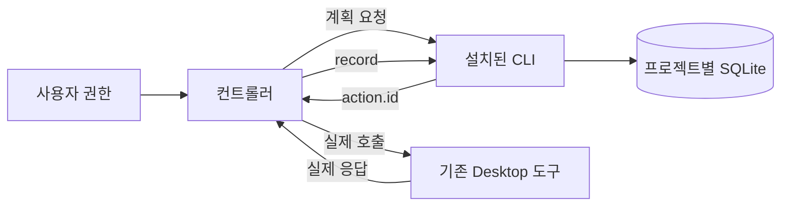

# Worker Orchestrator

기존 Codex Desktop 도구로 프로젝트별 워커 대화의 실행과 보관을 관리합니다.
컨트롤러는 사용자가 직접 허용한 범위에서 호스트 도구를 호출합니다.
공통 코어는 다음 action과 상태를 관리합니다.
MVP는 스킬·로컬 CLI·기존 Desktop 도구로 구성합니다.



Node.js 24 이상과 기본 제공 SQLite를 사용합니다.
공유된 소스 저장소에서 다음 명령으로 패키지를 생성하고 검사합니다.

```text
node builders/codex/build.mjs
node scripts/check-package.mjs
node --test
```

생성된 패키지는 `dist/codex/worker-orchestrator/`에 있습니다.
생성된 catalog의 루트는 `dist/codex/`입니다.
빌드는 플러그인을 등록하거나 설치하지 않습니다.
설치된 패키지의 시작 명령은 다음과 같습니다.

```text
node <설치 루트>/dist/cli.mjs capabilities
node <설치 루트>/dist/cli.mjs <command> --state-dir <절대 경로> --input <JSON 파일 또는 ->
```

`capabilities`는 로컬 지원 범위를 알려줍니다.
현재 대화의 공식 Desktop 도구 노출 여부는 별도로 확인합니다.
이미 등록된 부모 Desktop 프로젝트에서 하위 저장소를 작업 범위로 사용할 수 있습니다.
MVP는 새 Desktop 프로젝트를 자동 등록하지 않습니다.

- [사용법](docs/usage.md)은 명령별 JSON 입력과 후속 실행을 설명합니다.
- [구조](docs/architecture.md)는 컨트롤러와 코어의 책임을 설명합니다.
- [패키지 형식](docs/packaging.md)은 설치 경로와 무결성 검사를 설명합니다.
- [공통 계약](src/contracts/README.md)은 코어 입력과 action을 정의합니다.

실제 Desktop 생명주기 검증은 [검증 결과](docs/verification.md)에 기록합니다.
설치 복사본 테스트는 `.local/installed/`의 격리된 경로와 임시 상태 디렉터리를 사용합니다.
로컬 패키지 테스트와 실제 Desktop 도구 검증의 결과는 구분합니다.
