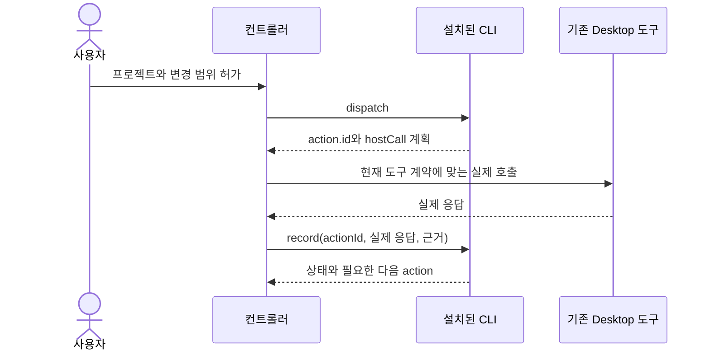

# 실행 책임

공통 코어는 프로젝트별 상태와 다음 action을 관리합니다.
Codex 어댑터는 action을 기존 Desktop 도구의 호출 계획으로 변환합니다.
컨트롤러는 사용자가 허용한 범위에서 실제 도구를 호출합니다.
CLI는 호스트 도구를 직접 실행하지 않습니다.

공통 절차는 패키지의 `workflows/`에 있습니다.
호스트별 스킬은 `skills/`에 있습니다.
설치된 실행 코드는 `lib/`에 있습니다.
`dist/cli.mjs`는 `lib/cli/main.mjs`의 `main()`을 호출합니다.
소스 저장소가 없어도 설치본의 상대 import가 유지됩니다.

`projectRoot`는 실제 작업 저장소의 절대 경로입니다.
`hostProjectId`는 Desktop에 이미 등록된 프로젝트의 식별자입니다.
기존 부모 프로젝트에서 하위 저장소를 작업 범위로 사용할 수 있습니다.
MVP는 새 Desktop 프로젝트를 자동 등록하지 않습니다.

보관은 동일 실행의 성공 결과·검증 통과·채택·대기 해제를 요구합니다.
후속 실행은 같은 대화를 재사용합니다.
보관된 대화는 복원 결과를 기록한 뒤 새 요청을 전달합니다.
새 실행은 이전 검증을 승계하지 않습니다.
불명확한 생성은 실제 대화를 확인하기 전까지 재전송하지 않습니다.

모델과 thinking은 요청 프로필입니다.
호스트가 적용값을 증명하지 않으면 실제 적용값은 미확인입니다.
로컬 `capabilities`의 출력은 호스트 도구의 현재 가용성을 증명하지 않습니다.
