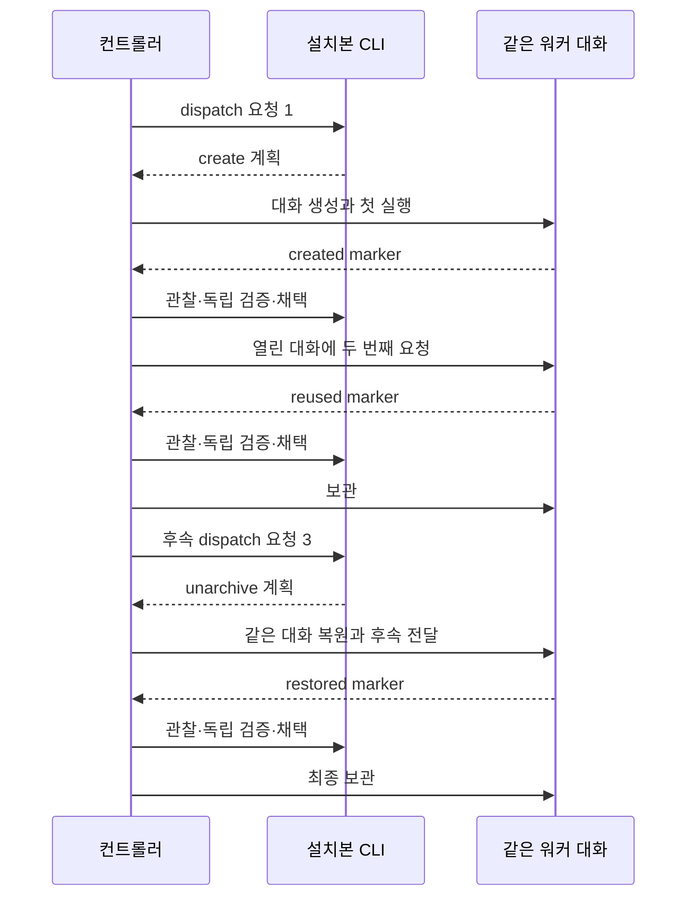

# Codex Desktop MVP 검증

## 초기 생명주기 검증

2026-11-18에 로컬 Codex Desktop의 실제 대화 도구와 Node.js 24.18.1로 검증했습니다.
대상 버전은 `worker-orchestrator` 0.1.0입니다.
실제 대화 결과는 당시 `.local/installed/worker-orchestrator/`에 복사한 설치본의 기록입니다.
새 저장소는 기존 `tttaliesin` Desktop 프로젝트 아래에 있습니다.
워커 대화는 그 Desktop 프로젝트에 생성하고 작업 범위는 이 Git 저장소로 제한했습니다.

### 로컬 검사

다음 명령은 실행 의존성 설치 없이 수행합니다.

```text
node --test
node builders/codex/build.mjs
node scripts/check-package.mjs
```

상태 코어·CLI·어댑터·패키지·이동 설치 테스트를 실행합니다.
최종 실행에서 테스트 35개가 통과했고 실패·생략은 없었습니다.
SQLite의 동시 최초 생성, 요청 재전송, 불명확한 생성 응답, 오래된 실행 결과와 대기 상태를 검사합니다.
패키지 검사는 파일 목록·SHA-256·상대 import·내부 문서 링크·manifest·스킬 발견 필드와 설치본 CLI 실행을 확인합니다.
공식 스킬 `quick_validate.py`는 기존 Python에 PyYAML이 없어 실행되지 않았습니다.
새 도구는 설치하지 않았으며 패키지 검사기의 필수 스킬 frontmatter 검사를 사용했습니다.

### 실제 대화 실행

설치 패키지는 `dist/codex/worker-orchestrator/`에서 `.local/installed/worker-orchestrator/`로 복사했습니다.
실제 검증의 모든 상태 명령은 복사한 설치본의 `dist/cli.mjs`로 실행했습니다.
컨트롤러와 워커는 그 설치 복사본의 스킬·워크플로를 읽었습니다.
전역 플러그인 등록은 수행하지 않았으므로 앱의 자동 발견·설치 캐시 로딩은 이 결과에 포함하지 않습니다.

컨트롤러는 `dispatch`가 반환한 `hostCall`을 현재 대화의 공식 도구로 실행했습니다.
각 응답은 `record`로 기록하고 `wait_threads`의 실제 결과를 `observe`에 전달했습니다.
사용자 요청은 검증용 워커의 생성·후속 전달·검증·보관·복원을 포함했습니다.

| 단계 | 실제 결과 |
| --- | --- |
| 생성 | 기존 Desktop 프로젝트에서 새 워커 대화 ID를 받았습니다. |
| 같은 요청 재조회 | 추가 호출 전에 동일 action ID와 runId가 유지됐습니다. |
| 첫 실행 | 워커가 `created` marker를 새로 생성했습니다. |
| 열린 워커 재사용 | 같은 대화 ID에 새 요청을 전달하고 새 runId의 `reused` marker를 받았습니다. |
| 검증 후 보관 | 컨트롤러 검증·채택 후 보관 응답을 기록했습니다. |
| 후속 복원 | 같은 대화 ID를 복원하고 새 요청을 전달했습니다. |
| 세 번째 실행 | 새 runId의 `restored` marker를 받았습니다. |
| 최종 보관 | 세 번째 실행의 검증·채택 후 보관했고 실제 보관 목록에서 확인했습니다. |



세 실행의 워커 ID는 `01a1ecea-d239-7201-81d7-974fb4f114f8`로 동일했습니다.
실행 ID는 각각 새로 생성됐습니다.
후속 실행의 검증은 `unverified`, 채택은 `false`로 초기화됐습니다.
각 marker는 runId·단계·실제 cwd·값 437·내용 해시를 컨트롤러의 `scripts/verify-live-marker.mjs`로 다시 확인했습니다.
세 실행 모두 컨트롤러 검증이 통과했습니다.
최종 상태는 `phase: complete`, `verification: passed`, `accepted: true`, `archived: true`입니다.

요청한 모델은 `gpt-6.1-sol`, 추론 강도는 `low`입니다.
호스트의 생성·전달 도구는 이 요청을 수락했습니다.
반환값에 적용 프로필이 없으므로 `effectiveProfile`은 `null`로 유지했습니다.

### 재현과 관찰 범위

[사용법](usage.md)의 프로젝트 등록과 dispatch 절차를 사용합니다.
검증 요청에서 설치된 worker-executor 스킬과 현재 runId를 워커에게 전달합니다.
워커는 저장소 루트에서 다음 명령으로 marker를 생성합니다.

```text
node tests/fixtures/worker-probe.mjs <현재-runId> created .local/live/markers/<현재-runId>.json
```

컨트롤러는 같은 저장소에서 다음 명령으로 워커가 생성한 marker를 독립 검증합니다.

```text
node scripts/verify-live-marker.mjs .local/live/markers/<현재-runId>.json <현재-runId> created <저장소-절대-경로>
```

후속 요청에는 새 requestId와 같은 taskId를 사용하고 단계만 `reused`, `restored`로 바꿉니다.
기존 marker를 덮어쓰지 않으므로 다시 실행할 때 새 상태 디렉터리와 실행 ID를 사용합니다.
원시 도구 응답·입력 JSON·독립 검증 결과·최종 요약은 Git 제외된 `.local/live/`에 남겨뒀습니다.

승인·입력 대기 보존은 합성 상태 테스트에서 확인했습니다.
실제 사용자 승인을 대신 만들거나 대기 질문을 만들지는 않았습니다.
이 검증은 배포된 스킬의 자동 발견과 컨트롤러 비활성 중의 백그라운드 감시를 확인하지 않습니다.
호스트 동작 후 응답이 유실되면 실제 상태를 대조해 기록할 때까지 재전송을 보류합니다.
여러 컨트롤러에 같은 호스트 호출 계획이 보이면 각 컨트롤러가 같은 계획을 다시 실행하지 않아야 합니다.
SQLite의 중복 계획 방지는 호스트 도구의 원격 실행을 정확히 한 번 보장하는 계약이 아닙니다.

## fd46dac 설치본의 Windows 경로 자동 복구 검증

2026-11-18에 로컬 카탈로그의 `worker-orchestrator@worker-orchestrator-local`을 `211cf32`에서 `fd46dac`으로 갱신했습니다.
Codex Desktop의 설치 목록에서 버전 `0.1.0`이 활성 상태인 것을 확인했습니다.
설치 캐시의 manifest SHA-256을 배포본과 대조했고, 설치본 검사에서 manifest가 가리키는 파일 19개가 모두 일치했습니다.
기존 검증 상태 DB를 복사해 보관된 검증 워커를 복원하고 같은 대화에서 새 실행을 시작했습니다.

| 단계 | 실제 관찰 |
| --- | --- |
| 대기 요약 | `wait_threads` 요약의 Windows 경로에서 백슬래시 이스케이프가 유실돼 `Bad escaped character in JSON` 오류가 발생했습니다. |
| 조회 계획 | 설치본 `observe`는 실제 요약을 그대로 받아 `unknown`을 기록하고 등록된 워커를 대상으로 `read_thread` 호출 계획을 반환했습니다. |
| 원문 조회 | 컨트롤러는 반환된 계획에 따라 `remote-control:…`의 요약에 해당하는 원문을 등록된 `local` 호스트에서 조회했습니다. |
| 결과 기록 | 설치본은 같은 워커·턴·최종 메시지 ID와 현재 `runId`가 일치하는 원문을 `completed`로 기록했습니다. |
| 재제출 | 같은 증거를 다시 보내도 이벤트 ID와 작업 버전이 유지됐습니다. |
| 보관 조건 | 검증 전 보관은 `ACCEPTANCE_REQUIRED`로 거부됐습니다. |
| 결과 검증 | 컨트롤러가 marker를 독립 검증하고 결과를 채택한 뒤 워커를 다시 보관했습니다. |

최종 상태는 `phase: complete`, `verification: passed`, `accepted: true`, `archived: true`입니다.
같은 워커가 실제 보관 목록에 있는 것도 확인했습니다.

### Windows 경로 재현 절차

`fd46dac`으로 만든 배포본의 로컬 카탈로그가 등록된 상태에서 다음 명령으로 플러그인을 갱신합니다.
갱신 명령이 반환한 설치 경로의 revision과 패키지 무결성을 확인합니다.

```powershell
$RecoveryPlugin = codex plugin add 'worker-orchestrator@worker-orchestrator-local' --json | ConvertFrom-Json
if ($LASTEXITCODE -ne 0) { throw 'Plugin update failed' }

$RecoveryPluginRoot = $RecoveryPlugin.installedPath
$RecoveryManifest = Get-Content -Raw -LiteralPath (Join-Path $RecoveryPluginRoot 'package-manifest.json') | ConvertFrom-Json
if ($RecoveryManifest.revision -ne 'fd46dac07d9be1b4a83a21fe1796acc17e2a8d58') {
    throw 'Unexpected installed revision'
}
codex plugin list --marketplace 'worker-orchestrator-local' --json
node (Join-Path $RecoveryPluginRoot 'scripts/check-package.mjs')
```

컨트롤러는 [사용법](usage.md)에 따라 검증 워커의 같은 작업에 새 `requestId`로 `dispatch`합니다.
보관된 워커는 복원 응답을 기록한 뒤 반환된 후속 전송 계획을 실행합니다.
워커에는 설치된 `worker-executor` 스킬 경로와 현재 `runId`를 전달합니다.

워커는 저장소 루트에서 다음 명령으로 marker와 최종 JSON을 만듭니다.

```powershell
$RecoveryRunId = '<dispatch가 반환한 현재 runId>'
$RecoveryMarker = ".local/live/markers/$RecoveryRunId.json"
$null = node tests/fixtures/worker-probe.mjs $RecoveryRunId restored $RecoveryMarker
if ($LASTEXITCODE -ne 0) { throw 'worker-probe failed' }

$RecoveryMarkerData = Get-Content -Raw -LiteralPath $RecoveryMarker | ConvertFrom-Json
if ($RecoveryMarkerData.runId -ne $RecoveryRunId -or $RecoveryMarkerData.phase -ne 'restored') {
    throw 'Unexpected marker run or phase'
}
[ordered]@{
    runId = $RecoveryRunId
    status = 'completed'
    summary = "cwd=$($RecoveryMarkerData.cwd)"
    verification = @{
        status = 'passed'
        evidenceRefs = @((Resolve-Path -LiteralPath $RecoveryMarker).Path.Replace('\', '/'))
    }
    pendingRequests = @()
} | ConvertTo-Json -Depth 6 -Compress
```

직렬화된 JSON 한 줄을 워커의 최종 메시지로 반환합니다.
`summary`에 실제 Windows 경로를 넣으면 JSON 원문에는 `cwd=F:\\workspace\\…`처럼 이중 백슬래시가 들어갑니다.
실측 `wait_threads` 요약에서는 같은 부분이 `cwd=F:\workspace\…`로 바뀌어 첫 `\w`에서 파싱이 실패했습니다.

1. 컨트롤러는 실제 `wait_threads` 응답을 그대로 `hostResult`로 전달해 설치본 CLI의 `observe`를 호출합니다.
2. 결과가 `unknown`이고 `hostCall`이 `read_thread`를 가리키면 반환된 인수로 조회를 실행합니다.
3. 같은 `observe` 입력에 조회 응답 `readThreadResult`와 원문 근거 경로 `readThreadEvidenceRef`를 추가해 다시 호출합니다.
4. 워커·턴·메시지 ID와 `runId`가 일치하면 설치본이 결과를 `completed`로 기록하고 작업은 `review` 단계로 이동합니다.
5. 컨트롤러는 `node scripts/verify-live-marker.mjs <marker> <runId> restored <저장소-절대-경로>`로 marker를 독립 검증한 뒤, 해당 결과의 이벤트 ID로 `verify`를 기록하고 `accept`합니다.

성공 기준은 가공 전 대기 요약에서 파싱 오류가 발생하고 같은 메시지의 원문으로 복구되는 것입니다.
요약 JSON이 유효하면 이 실행으로 자동 원문 조회 경로를 확인할 수 없습니다.
원문 조회가 실패하거나 식별자가 다르면 확인 가능한 대기 상태 또는 미확인 상태로 남습니다.

실측 증거는 Git에서 제외된 `.local/desktop-install/fd46dac-4d09bf3f/`에 있습니다.
이 디렉터리의 `reports/proof.json`은 실측 요약입니다.
가공 전 응답은 `responses/probe-wait-compact.json`과 `responses/probe-read-original.json`에 있습니다.
자동 테스트는 `node --test --test-name-pattern='collapsed Windows path' tests/cli/lifecycle.test.mjs`로 실행할 수 있습니다.
