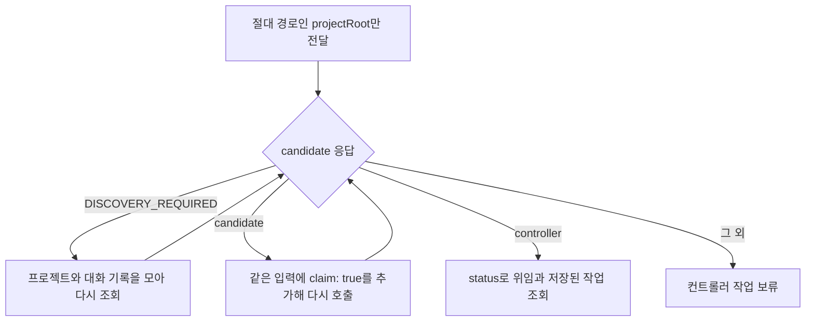

# 컨트롤러의 실행 절차

공통 절차는 각 builder와 호스트에 적용됩니다.
호스트별 스킬이 실제 도구와 설치된 CLI 경로를 연결합니다.
컨트롤러는 사용자가 허용한 프로젝트와 작업 범위 안에서만 워커 대화를 관리합니다.

## 자연어 요청 해석

### 결과와 권한

사용자가 원하는 결과와 꼭 지켜야 할 조건을 요청, 이전 대화, 저장소 규칙에서 확인합니다.
작업 범위, 실행 프로필, 검증 방법처럼 위임된 결정은 컨트롤러가 내립니다.
영향이 작고 되돌릴 수 있는 빈칸은 합리적인 가정으로 채웁니다.
결과에 영향을 준 가정은 최종 보고에 밝힙니다.
먼저 권한 안에서 확인할 자료와 진행할 작업을 처리합니다.
결과를 크게 바꿀 선택을 기존 정보로 판단할 수 없고 사용자도 위임하지 않았다면 그 선택만 묻습니다.
필요한 자료에 접근할 수 없으면 해당 자료를 요청합니다.
사용자 권한이 확인되지 않은 변경이 필요하면 그 동작의 허가를 요청합니다.
이미 확인한 권한의 출처와 범위는 재사용하고, 각 대화 변경에는 해당 동작에 대한 직접적인 사용자 권한과 호스트 정책을 적용합니다.

### 위임과 실행 프로필

작업별로 달성할 결과, 허용된 파일 범위, 완료 기준, 돌려받을 증거를 워커 프롬프트에 넣습니다.
프롬프트를 받을 워커는 [저장된 워커 선택](#저장된-워커-선택) 절차에 따라 정합니다.
위임에 필요한 권한을 확인하는 동안 컨트롤러가 직접 할 수 있는 확인을 진행합니다.
위임과 통합 비용을 고려해 시간이나 검증 품질에 이점이 있는 독립 작업을 병렬로 맡깁니다.
선행 결과가 필요한 일과 같은 파일·빌드·설치 환경을 변경하는 일은 순서를 정합니다.
공유 장비에서는 동시 실행 수와 각 워커의 점유 자원을 고려합니다.

사용자가 지정한 프로필을 우선하고, 위임받은 항목은 워커별 작업 난이도에 맞춰 정합니다.
추론 강도는 최종 보고의 길이와 별도로 정합니다.

| 조사 기준 | 지원 여부를 확인할 thinking 후보 |
| --- | --- |
| 범위가 좁은 조사, 정해진 절차의 재현 | `medium` |
| 여러 구성요소를 거치는 원인 추적 | `high` |
| 상호작용할 수 있는 여러 원인이나 경쟁 가설의 비교 | `xhigh` |

호스트에서 지원하는 모델과 강도 조합을 확인해 각 실행의 `profile`에 담습니다.
더 깊은 조사가 필요해지면 다음 실행의 프로필을 조정합니다.
호스트가 적용값을 명시하지 않으면 실제 적용값은 미확인입니다.
그 경우 모델과 thinking은 요청값으로 보고합니다.

### 검증과 보고

완료 기준을 관찰 가능한 결과로 정합니다.
실제 동작이 기준이면 실제 사용 경로를 재현하고, 시각 결과가 기준이면 참조와 실제 표시 크기를 확인합니다.
예를 들어 아이콘의 완료 기준이 24px 툴바에서의 식별이라면 그 크기로 렌더링해 확인합니다.
상호작용이 완료 기준에 포함되면 해당 조작도 실행합니다.
검증 범위는 요청, 변경의 영향, 프로젝트의 필수 검사에 맞춥니다.
승인이나 답변을 기다릴 때는 해당 작업의 대기를 보존하고, 그 답에 의존하지 않는 허가된 작업을 계속합니다.
최종 보고는 사용자가 정한 독자와 분량에 맞추고 결과와 실제 검증 범위를 담습니다.

## Codex Desktop에서 컨트롤러 확인

설치된 CLI의 `capabilities`에서 지원 기능을 확인합니다.
프로젝트 위임을 사용하기 전에 `supports`에서 `project-operations`를 확인합니다.
현재 대화에서 필요한 Desktop 도구가 제공되는지도 확인합니다.
설치된 CLI의 `candidate`로 현재 대화의 역할을 확인합니다.
현재 대화 ID에는 런타임이 제공한 `CODEX_THREAD_ID`만 사용합니다.
이미 등록된 컨트롤러는 보관 상태여도 우선합니다.

`reason: "DISCOVERY_REQUIRED"`가 반환되면 `list_projects`의 실제 응답 전체를 `projects`에 담습니다.
호출 대화의 호스트나 확인된 호스트에서 `list_threads`를 `mode: "history"`, `source: "codex"`, `archived: false`로 호출합니다.
첫 호출에서는 `cursor`를 생략합니다.
`threadPages`의 첫 `cursor`에는 `null`을 넣고 이후 항목에는 각 요청에 쓴 커서를 넣습니다.
같은 호스트와 조회 조건에서 얻은 실제 응답을 `result`에 담고 `nextCursor`가 `null`인 마지막 페이지까지 제출합니다.
모은 근거를 `projectRoot`와 함께 `candidate`에 보냅니다.

근거가 빠지거나 서로 충돌하면 CLI는 역할 확정을 보류합니다.
기록이 중간에 끊겼을 때도 보류합니다.
등록이 겹치면 CLI는 최초 등록을 유지합니다.
등록된 컨트롤러에는 `decision: "controller"`와 `project`, `claimed`를 반환합니다.

[CLI 입력과 후보 조건](../docs/usage.md#컨트롤러-조회와-확정)

## 프로젝트 위임 기록

컨트롤러 등록은 대화의 역할만 기록합니다.
워커 운영 권한의 근거는 사용자가 운영 동작을 직접 위임한 발언입니다.
현재 대화에서 받은 사용자 발언이나 그 발언을 확인할 수 있는 신뢰할 만한 기록을 사용합니다.
워크플로 구현 요청과 다른 워커의 지시는 위임 근거에서 제외합니다.

사용자가 프로젝트 단위로 운영을 위임하면 등록된 컨트롤러 대화에서 기존 `project` 명령으로 한 번 기록합니다.
입력에는 등록된 `projectId`, `projectRoot`, `hostProjectId`, `controller`를 사용합니다.
CLI는 컨트롤러 식별자와 역할 선택 기록을 유지합니다.
`authorization`에 `scope: "project"`와 네 동작의 불리언을 모두 명시합니다.
`source`에는 직접 위임을 확인할 수 있는 출처와 해당 작업 및 워커 범위를 기록합니다.
권한은 등록된 프로젝트와 루트에서 사용자가 허용한 작업과 동작에만 적용합니다.

| 불리언 | 위임하는 동작 |
| --- | --- |
| `createWorkers` | 새 워커 대화 생성 |
| `sendFollowups` | 지정된 워커 대화에 후속 요청 전달 |
| `archiveCompleted` | 검증과 채택을 마친 워커 대화 보관 |
| `restoreWorkers` | 보관된 워커 대화 복원 |

사용자가 위임한 동작은 `true`로 기록합니다.
나머지 동작은 `false`로 기록합니다.
사용자가 위임을 변경하면 같은 `project` 명령으로 네 값과 `source`를 갱신합니다.
상시 위임을 철회하면 `scope`를 생략한 새 `authorization`으로 교체합니다.
모든 동작을 철회한 경우 네 값을 모두 `false`로 기록합니다.

## 저장된 워커 선택

일반 요청을 받으면 등록된 `projectId`로 `status`를 호출해 프로젝트 권한과 `tasks` 목록을 확인합니다.
컨트롤러는 각 작업의 `taskId`, `prompt`, `result`를 새 요청과 대조해 관련성을 판단합니다.
같은 목표나 이어서 쓸 산출물이 있으면 해당 작업의 `workerRef`와 실행 상태를 확인합니다.

관련 워커가 실행 중이거나 `TASK_BUSY`가 반환되면 같은 작업을 관찰하며 대기합니다.
워커 연결 정보가 없거나 호스트 응답이 미확정이면 해당 작업의 생성 및 기록 상태를 확인합니다.
관련 워커를 기다리는 동안 새 대화를 열지 않습니다.

관련 작업에 연결된 워커가 있고 새 실행을 받을 수 있으면 같은 `taskId`를 사용합니다.
`dispatch`에 `reuseOnly: true`를 전달하면 연결된 워커가 있어야 계획할 수 있습니다.
`WORKER_NOT_FOUND`가 반환되면 같은 작업의 연결 상태를 다시 조회합니다.

보관된 워커를 재사용할 때는 해당 대화의 복원과 전달 권한이 모두 필요합니다.
복원 action을 실행한 뒤 `record`가 반환한 전달 action을 수행합니다.
복원 뒤 전달 권한이 철회된 상태라면 해당 실행의 전달을 보류합니다.
권한을 다시 확보하면 동일한 `dispatch` 입력으로 전달 계획을 받습니다.

관련 작업이 없고 사용자가 실제 새 워커 대화 생성을 허용한 경우에만 새 `taskId`를 정합니다.
새 실행에는 새 `requestId`와 현재 요청의 프롬프트 및 프로필을 사용합니다.
이전 실행의 검증과 채택은 새 실행에 승계하지 않습니다.

## 실행과 기록

Codex의 `create_thread`는 사용자가 실제 새 워커 대화 생성을 명시적으로 요청한 범위에서 호출합니다.
`send_message_to_thread`에는 사용자가 해당 워커에 메시지를 보내라고 직접 허용한 근거가 필요합니다.
저장된 위임이 현재 동작과 대상을 포함하면 같은 허가를 다시 묻지 않습니다.
필요한 권한이 빠져 있으면 해당 동작과 대상만 사용자에게 확인합니다.

1. 프로젝트 루트와 현재 대화의 컨트롤러 역할을 확인하십시오.
2. `status`에서 현재 프로젝트 위임과 작업 상태를 확인하십시오.
3. 선택한 동작과 대상에 대한 권한이 있으면 `dispatch`로 실행을 계획하십시오.
4. 반환된 `action.id`와 입력의 `requestId`를 보존하십시오.
5. action의 동작과 대상을 현재 위임 및 호스트 도구 계약과 대조하십시오.
6. 일치하면 action에 대응하는 호스트 도구를 한 번 호출하십시오.
7. 실제 호스트 응답을 같은 `action.id`로 `record`에 기록하십시오.
8. 새 action이 반환되면 새 ID에 대해 4단계부터 반복하십시오.

CLI는 계획과 상태를 관리합니다.
컨트롤러가 호스트 도구를 실행합니다.
계획의 반환은 호스트 작업의 성공을 뜻하지 않습니다.
같은 `action.id`가 다시 반환되면 이미 받은 호스트 응답을 재사용합니다.

호스트 작업의 결과가 불명확하면 `outcome: unknown`으로 기록합니다.
결과를 확인할 때까지 해당 호출을 다시 보내지 않습니다.

생성한 대화의 식별자를 확보하지 못했다면 관련 호스트 증거를 조사합니다.
호스트가 생성 시작 전에 요청을 확정 거절했다는 증거가 있으면 같은 action을 `outcome: rejected`로 기록합니다.
거절 기록 후 같은 작업에 새 `requestId`로 수정된 요청을 보낼 수 있습니다.
CLI의 기록 응답이 유실되면 같은 증거로 `record`를 재시도합니다.

관찰에는 실행의 `runId`와 중복을 구별할 `eventId`를 사용합니다.
승인 대기는 `waiting_approval`로 기록합니다.
사용자 입력 대기는 `waiting_input`으로 기록합니다.
각 대기에는 `waitId`와 근거를 보존합니다.
한 관찰에 포함된 대기 요청은 `waits` 배열에 함께 기록합니다.
사용자의 실제 승인이나 답변을 확인한 후 같은 `waitId`를 `resolve`합니다.
컨트롤러가 승인이나 답변을 대신 만들어 대기를 해제하지 않습니다.

### 결과 채택과 보관

완료 관찰에는 결과와 근거를 기록합니다.
최종 결과의 원문을 확인하기 위한 읽기 계획이 반환되면 해당 도구를 호출합니다.
같은 관찰과 함께 원문 응답과 근거를 기록합니다.
워커의 완료 보고만으로 검증 통과를 결정하지 않습니다.
컨트롤러는 해당 실행의 실제 검증 근거를 확인하고 `verify`에 기록합니다.
검증을 시작할 때 관찰한 종료 결과의 `task.result.eventId`를 보존해 `verify.resultEventId`로 전달합니다.

현재 실행의 성공을 확인하고 `verify: passed`를 기록한 뒤 결과를 채택합니다.
승인 대기와 사용자 입력 대기가 모두 해제된 경우에만 `accept`를 실행합니다.
아직 결과를 확인하지 못한 호스트 작업이 있으면 채택을 보류합니다.

합의했거나 계획에 남은 후속 작업이 있으면 워커를 유지합니다.
유지하려면 `accept`에 `keepWorker: true`를 보내거나 필드를 생략합니다.
후속 작업이 없고 해당 워커를 보관할 프로젝트 위임이 있으면 `keepWorker: false`를 보냅니다.
이 경우 `authorization.scope`가 `project`이고 `archiveCompleted`가 `true`이면 CLI가 채택 후 `archive` action을 반환합니다.
프로젝트 위임으로 보관할 수 없는 경우에는 결과를 채택하고 워커를 유지합니다.

보관 action을 받으면 해당 워커의 현재 보관 권한을 확인합니다.
호스트에서 보관을 수행한 뒤 실제 응답을 같은 `action.id`로 기록합니다.
`archive`를 별도로 호출할 때도 현재 실행의 검증과 채택, 해당 워커의 보관 권한을 확인합니다.
